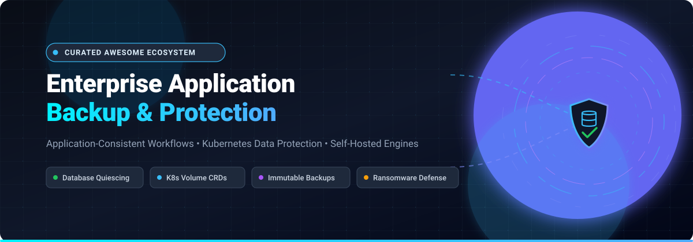
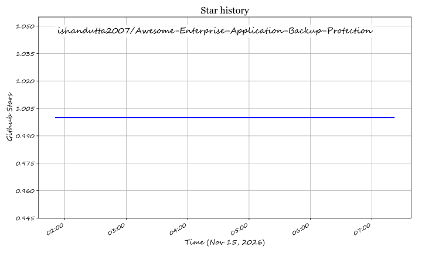

# 🛡️ Awesome-Enterprise-Application-Backup-Protection

<p align="center">
  
</p>

<p align="center">
  <a href="https://github.com/ishandutta2007/Awesome-Awesome-Awesome"></a>
  <a href="https://discord.gg/jc4xtF58Ve"></a>
  <a href="https://github.com/ishandutta2007/Awesome-Enterprise-Application-Backup-Protection/stargazers"></a>
  <a href="https://github.com/ishandutta2007/Awesome-Enterprise-Application-Backup-Protection/network/members"></a>
  <a href="https://github.com/ishandutta2007/Awesome-Enterprise-Application-Backup-Protection/blob/main/LICENSE"></a>
  <a href="https://github.com/ishandutta2007"></a>
</p>

---

## 🌐 Curated List of Enterprise Application Backup & Data Protection Ecosystem

> **A comprehensive directory of enterprise-grade SaaS platforms, Kubernetes data protection solutions, and open-source application-consistent backup frameworks.**  
> *Engineered for platform engineers, SREs, backup administrators, and DevOps teams protecting critical production workloads against ransomware, human error, and disaster scenarios.*

---

## 📑 Table of Contents

- [📊 Sector Overview & Market Dynamics](#-sector-overview--market-dynamics)
- [☁️ Enterprise SaaS & Hosted Platforms](#️-enterprise-saas--hosted-platforms)
- [💻 Open-Source Backup Frameworks & Engines](#-open-source-backup-frameworks--engines)
- [🤝 How to Contribute](#-how-to-contribute)
- [💖 Support & Sponsorship](#-support--sponsorship)
- [⚠️ Disclaimer](#️-disclaimer)
- [📈 Star History](#-star-history)

---

## 📊 Sector Overview & Market Dynamics

The enterprise data protection and application backup market represents an estimated global market size of **$14.5 billion to $18.2 billion** (projected to exceed **$28+ billion by 2030** with an ~11.5% CAGR), driven by strict regulatory compliance requirements (NIS2, DORA) and the escalating imperative for cyber-resilient, cleanroom ransomware recovery. The sector is **moderately fragmented yet increasingly polarized**: traditional enterprise workloads and cyber-recovery suites are heavily consolidated around top-tier market leaders (Veeam, Cohesity/Veritas, Rubrik, Commvault), while high-growth niches in Kubernetes-native stateful backup, multi-cloud SaaS BaaS, and verifiable open-source snapshot engines foster vibrant innovation and specialized alternatives.

---

## ☁️ Enterprise SaaS & Hosted Platforms

Enterprise SaaS and cloud-managed data protection platforms offer turnkey orchestration, centralized policy compliance, deduplicated cloud storage, and AI-powered anomaly detection.

*Sorted in descending order by enterprise scale (Company Valuation / Annual Recurring Revenue).*

| Rank | Product / Platform | Company Scale (Valuation / Revenue) | Description & Key Capabilities | Specific Starting Tier Pricing | Free Tier / Free Trial Limits |
|:---:|:---|:---|:---|:---|:---|
| 1 | **[Veeam](https://www.veeam.com/)** | **~$15 Billion Valuation** / ~$1.7B+ ARR | Enterprise cyber resilience leader offering application-consistent backups, Veeam Agents, and orchestrated instant recovery across virtual, physical, and hybrid cloud workloads. | **$95.00 / workload / year** (~$7.92/workload/month for Veeam Essentials small-business tier) | **Permanently Free**: Veeam Community Edition covers up to **10 workloads** forever. Full Veeam Data Platform includes a **30-day free trial**. |
| 2 | **[Cohesity](https://www.cohesity.com/)** | **~$7 Billion – $8 Billion Valuation** / ~$1.7B+ pro forma revenue | AI-powered data security and data management platform featuring DataProtect as a Service (DPaaS), cleanroom recovery, and cyber vaulting (FortKnox). | **$20.00 – $25.00 / TB / month** (cloud-native DPaaS entry packages starting at ~$29,100/yr for 10 BETB) | **30-day free trial** of Cohesity Cloud Services / BaaS with full console access upon registration. |
| 3 | **[Datto SaaS Protection](https://www.datto.com/)** *(Kaseya)* | **$6.2 Billion Acquisition** / Parent ARR $1.5B+ | Specialized cloud-to-cloud application protection built for MSPs, safeguarding Microsoft 365 (Exchange, OneDrive, SharePoint, Teams) and Google Workspace. | **$1.50 – $3.00 / user / month** wholesale baseline MSP pricing (street retail typically $2.00–$4.50/user/month) | **14-day free trial** with automated backup testing and single-click restoration across M365 and Google Workspace. |
| 4 | **[Rubrik](https://www.rubrik.com/)** | **~$6 Billion – $7.5 Billion Market Cap** / ~$1.5B+ Sub. ARR | Zero Trust data security leader offering automated immutable backups, sensitive data discovery, threat hunting, and rapid ransomware cleanroom recovery. | **$9.00 – $10.00 / VM / month** for Cloud-Native edition; standard capacity tiers list at **$130.00 / TB / month** | **No permanent free tier**. Structured **30-day enterprise Proof-of-Concept (PoC)** / guided pilot via sales. |
| 5 | **[Commvault](https://www.commvault.com/)** | **~$4.5 Billion Market Cap** / ~$1.18B Annual Revenue | Enterprise-grade cyber resilience platform providing Commvault Cloud with Metallic AI engine, autonomous recovery, and multi-cloud workload protection. | **$1.70 / user / month** for Microsoft 365 SaaS backup; VM protection packages start at **$58.00 / TB / month** | **30-day free trial** for Commvault Cloud workloads with full feature access and self-service signup (no credit card required). |
| 6 | **[Acronis](https://www.acronis.com/)** | **~$3.5 Billion Valuation** / ~$430M Annual Revenue | Unified cyber protection integrating backup, disaster recovery, and next-gen anti-ransomware protection for physical servers, endpoints, and virtual environments. | **$7.00 / workstation / month** (or ~$85.00/workstation/year for Cyber Protect Standard edition) | **30-day free trial** of Acronis Cyber Protect Cloud with full backup, anti-malware, and management features enabled. |
| 7 | **[Druva](https://www.druva.com/)** | **~$2 Billion Valuation** / ~$200M+ SaaS ARR | 100% SaaS-native Data Resiliency Cloud providing automated agentless backup, global deduplication, and immutable storage across AWS, Microsoft 365, and VMware. | **$150.00 / TB / month** consumption credit (measured strictly on post-deduplicated, compressed storage footprint) | **30-day free trial** of Druva Data Resiliency Cloud with live onboarding, guided workflows, and sample workload protection. |
| 8 | **[HYCU](https://www.hycu.com/)** | **~$600 Million Valuation** / ~$50M+ ARR | Multi-cloud and SaaS-native data protection platform (R-Cloud) covering 100+ cloud services, Kubernetes clusters, Atlassian, Okta, and on-premises Nutanix/VMware. | **$1.20 / user / month** (Workforce Identity Suite) and **$2.25 / user / month** for Microsoft 365; starter bundles from **$5,000 / year** | **14-day free trial** of HYCU R-Cloud; extended **30-day free trial** available for Okta and Microsoft Entra ID protection. |

---

## 💻 Open-Source Backup Frameworks & Engines

Open-source backup tools provide complete data sovereignty, eliminate per-workload or per-TB vendor licensing lock-in, and allow platform teams to define custom application-consistent workflows as code.

*Sorted in descending order by GitHub_Stars ⭐.*

| Rank | Project | GitHub_Stars & Community Badge | Primary Architecture & Application Focus | Key Features & Enterprise Capabilities |
|:---:|:---|:---:|:---|:---|
| 1 | **[Restic](https://github.com/restic/restic)** | [](https://github.com/restic/restic/stargazers) | Fast, secure, cross-platform backup program written in Go | Content-defined deduplication, client-side AES-256 encryption, native backend support for AWS S3, Google Cloud Storage, Azure Blob, MinIO, SFTP, and local storage. Requires external pre/post hook scripts for database quiescing. |
| 2 | **[Duplicati](https://github.com/duplicati/duplicati)** | [](https://github.com/duplicati/duplicati/stargazers) | Free backup client with web UI for Windows, macOS, and Linux servers | Strong AES-256 encryption, incremental chunk deduplication, built-in scheduler, intuitive web administration dashboard, and integrations with standard cloud storage protocols (S3, WebDAV, FTP, B2). |
| 3 | **[Kopia](https://github.com/kopia/kopia)** | [](https://github.com/kopia/kopia/stargazers) | Modern Go-based deduplicating backup engine with CLI and GUI | Fast zero-knowledge client-side encryption, content-addressable storage, snapshot verification, mountable repositories, and multi-user repository server mode suitable for enterprise automation. |
| 4 | **[BorgBackup](https://github.com/borgbackup/borg)** | [](https://github.com/borgbackup/borg/stargazers) | Battle-tested deduplicating archiver for Unix and Linux environments | Authenticated AES-256/ChaCha20 encryption, LZ4/Zstandard compression, snapshot pruning retention policies, and FUSE filesystem mounting for rapid granular inspection and restore operations. |
| 5 | **[Velero](https://github.com/vmware-tanzu/velero)** | [](https://github.com/vmware-tanzu/velero/stargazers) | Industry-standard Kubernetes cluster backup, migration, and disaster recovery | Backs up Kubernetes cluster resources and Persistent Volumes (PVs) via CSI snapshotting and Restic/Kopia integration. Supports application-consistent pre/post exec hooks to flush and quiesce databases prior to snapshotting. |
| 6 | **[Plakar](https://github.com/plakarkorp/plakar)** | [](https://github.com/plakarkorp/plakar/stargazers) | Verifiable, encrypted application snapshot engine written in Go | Built atop Kloset immutable storage with audited end-to-end encryption. Features first-class application integrations for PostgreSQL, MySQL, etcd, and Kubernetes. Snapshots are independently verifiable without full data restores. |
| 7 | **[Bareos](https://github.com/bareos/bareos)** | [](https://github.com/bareos/bareos/stargazers) | Enterprise-scale network backup and disaster recovery suite (Fork of Bacula) | Multi-tier architecture (Director, Storage Daemon, File Daemon) supporting tape, disk, and cloud object stores. Native application plugins for MSSQL, Oracle, PostgreSQL, MySQL, LDAP, and VMware hypervisors. |
| 8 | **[Kanister](https://github.com/kanisterio/kanister)** | [](https://github.com/kanisterio/kanister/stargazers) | CNCF Sandbox application-consistent data management framework for Kubernetes | Extensible YAML Blueprint controller that coordinates multi-step application backup workflows: freezing database transactions, taking storage snapshots, dumping schemas, push-to-object-storage, and unfreezing stateful apps. |
| 9 | **[Vanguard](https://github.com/vanguardbackup/vanguard)** | [](https://github.com/vanguardbackup/vanguard/stargazers) | Self-hosted server and database backup management platform | Modern web UI for scheduling automated dumps and file backups across Debian/Ubuntu nodes. Out-of-the-box support for MySQL/PostgreSQL databases, multi-channel alerts (Slack, Discord, Email), 2FA, and encrypted remote storage. |
| 10 | **[backup-ns](https://pkg.go.dev/github.com/allaboutapps/backup-ns)** | [](https://github.com/allaboutapps/backup-ns/stargazers) | Kubernetes namespace snapshot backup controller with retention automation | Leverages Kubernetes VolumeSnapshotClass with `deletionPolicy: Retain` to shield stateful application volumes from accidental namespace deletion, with configurable daily, weekly, and monthly pruning schedules. |

---

## 💡 Selecting the Right Application Backup Strategy

```
                          ┌─────────────────────────────────────┐
                          │ What is your primary backup target? │
                          └──────────────────┬──────────────────┘
                                             │
             ┌───────────────────────────────┴───────────────────────────────┐
             ▼                                                               ▼
   ┌──────────────────┐                                            ┌──────────────────┐
   │ Kubernetes State │                                            │ Server/Database/ │
   │   & Microservices│                                            │  Hybrid Cloud    │
   └─────────┬────────┘                                            └─────────┬────────┘
             │                                                               │
     ┌───────┴───────┐                                               ┌───────┴───────┐
     ▼               ▼                                               ▼               ▼
┌───────────┐ ┌─────────────┐                                  ┌───────────┐ ┌─────────────┐
│ Complete  │ │ Workflows & │                                  │ Turnkey   │ │ Self-Hosted │
│ Cluster DR│ │ Database CRD│                                  │ Enterprise│ │ Engine / UI │
├───────────┤ ├─────────────┤                                  ├───────────┤ ├─────────────┤
│  Velero   │ │  Kanister   │                                  │   Veeam   │ │   Plakar    │
│           │ │             │                                  │  Rubrik   │ │   Restic    │
│           │ │             │                                  │ Commvault │ │   Bareos    │
└───────────┘ └─────────────┘                                  └───────────┘ └─────────────┘
```

- **For Kubernetes-native workloads:** Combine **Velero** (for entire cluster state, manifests, and CSI storage volume snapshots) with **Kanister** (for application-aware blueprints that quiesce PostgreSQL, MySQL, Elasticsearch, or Cassandra before taking snapshots).
- **For enterprise compliance & cleanroom recovery:** Evaluate **Veeam**, **Cohesity**, or **Rubrik** when requirements dictate automated cyber-recovery sandboxes, air-gapped immutability, and compliance auditing under enterprise SLAs.
- **For self-hosted Linux & database backup:** Deploy **Plakar** or **Kopia** for fast, verifiable deduplicated snapshots, or **Bareos** when cross-network client-server agent architecture is required across heterogeneous infrastructure.

---

## 🤝 How to Contribute

We welcome community contributions from backup architects, platform engineers, and open-source maintainers! 🚀

1. 🍴 **Fork the repository** on GitHub.
2. 🌿 **Create a feature branch**:
   ```bash
   git checkout -b feat/add-new-backup-platform
   ```
3. 📝 **Add or update an entry** in `README.md` maintaining consistent formatting:
   - For SaaS tools: include verified starting tier pricing, free tier/trial limits, and company scale.
   - For Open-Source projects: provide the social white Stars_Badge linking to `/stargazers`, repository summary, and architectural focus.
4. 📬 **Submit a Pull Request** with a brief summary of why the project fits enterprise application protection.

---

## 💖 Support & Sponsorship

If you find this curated resource helpful for your infrastructure, disaster recovery planning, or enterprise evaluation:

- ⭐ **Star this repository** to help others discover it!
- 🍴 **Fork and share** with your DevOps and platform engineering teams.
- ☕ **Support continuous maintenance**: You can sponsor or buy a coffee via the [GitHub Sponsors Dashboard](https://github.com/sponsors/ishandutta2007).

Thank you for supporting open, verifiable, and resilient enterprise data infrastructure! 🙌

---

## ⚠️ Disclaimer

- This curated list is maintained for educational, technical evaluation, and informational purposes. Mention of proprietary SaaS products does not constitute a formal commercial endorsement.
- Enterprise pricing, trial specifications, and product packaging change periodically; always verify exact figures with authorized vendor representatives before committing to production contracts.
- **Application consistency requirement**: Simple filesystem or crash-consistent block storage volume snapshots are generally insufficient for active distributed databases. Always ensure proper transaction quiescing and write flushing (via database-specific hooks, VSS writers, or Kubernetes CRD blueprints) prior to snapshot operations.

---

## 📈 Star History

[](https://www.star-history.com/#ishandutta2007/Awesome-Enterprise-Application-Backup-Protection&type=date&legend=top-left)

## ⭐ Star History

<a href="https://star-history.com/#ishandutta2007/Awesome-Enterprise-Application-Backup-Protection&Timeline" align="center">
  <picture>
    <source media="(prefers-color-scheme: dark)" srcset="assets/ishandutta2007_Awesome-Enterprise-Application-Backup-Protection_growth.svg">
    
  </picture>
</a>
